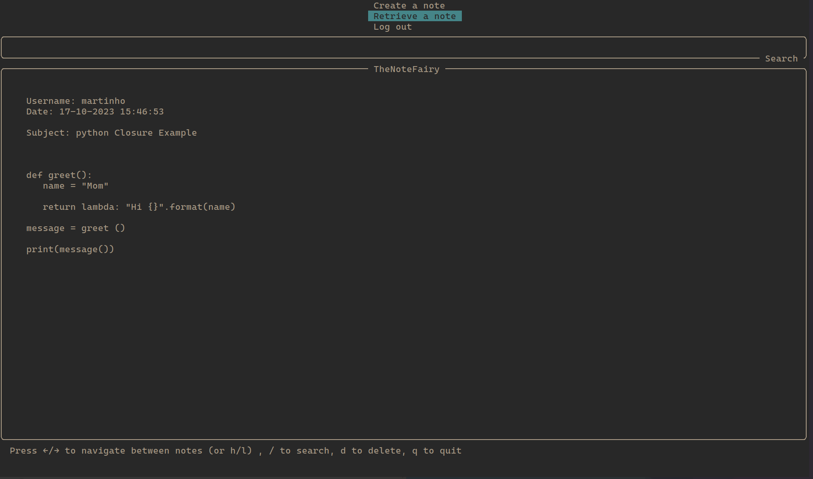
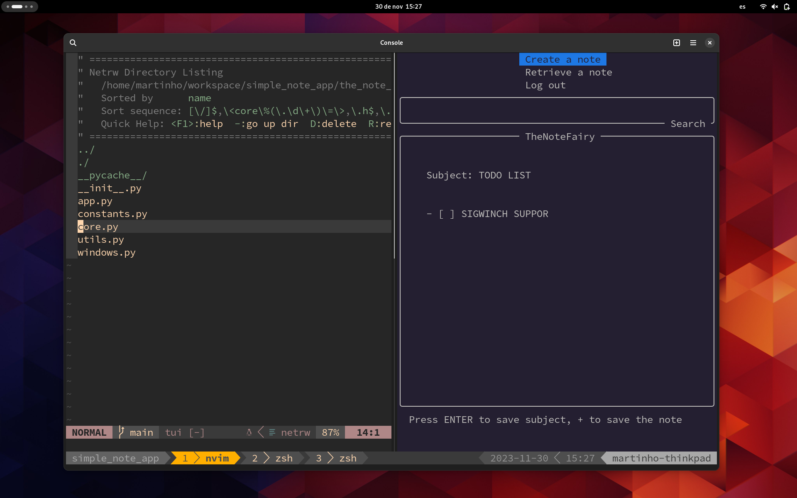
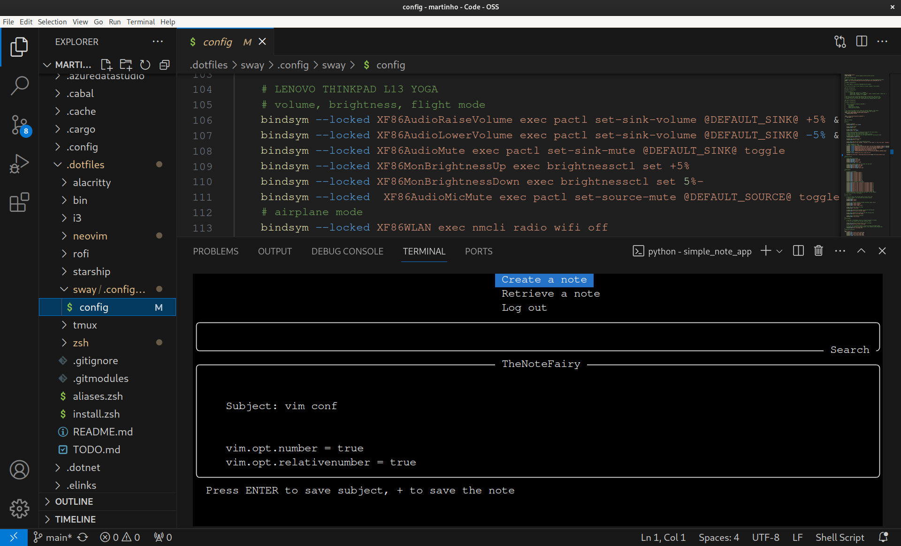

<div align="center">

# TheNoteFairy

A **multi-user TUI** to take notes/snippets with vim-like keybindings using [ncurses](https://invisible-island.net/ncurses/announce.html).

Inspired by one python assignment of my course in Finland (XAMK)


</div>

---



> retrieving a note



> Normal workflow with tmux and vim



> Opening TheNoteFairy with VSCode terminal

## CAPABILITIES
- Create, Retrieve and Delete notes with different isolated users.
- Search notes for date, subject or content.
- Import notes from json with `notes.json` in the source folder. (Ex: see `notes2.json` in the source folder and change name and access user admin)
- Fetch the title of the webpage stored.
- All notes and users are stored in a sqlite3 database.
- Users passwords are encrypted.

## INSTALLATION
- Clone the repository
```bash
git clone git@github.com:martimolanes/TheNoteFairy.git
```

- Install the requirements
```bash
pip install -r requirements.txt
```

- Run the application
```bash
python the_note_fairy/the_note_fairy.py
```
## KNOWN PROBLEMS
- application doesn't FULLY support resizing the terminal
- application MAY crash with small terminal size -> recommended big-size window
